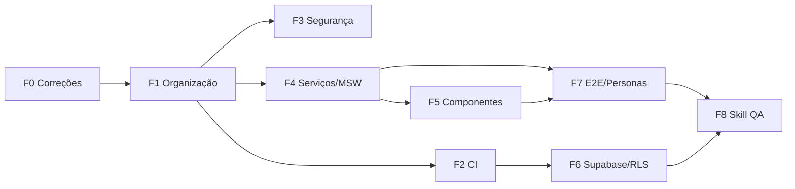

<!-- @module docs/qa/TEST_HARDENING_PLAN.md | Plano mestre de endurecimento da suíte de testes do WalletNow -->

# Plano de Implementação — Endurecimento da Suíte de Testes

- **Branch:** `fix/test-suite-hardening`
- **Criado em:** 2026-11-10
- **Status geral:** 🟢 Fases 0, 1, 2, 3 e 8 concluídas; Fase 4 iniciada

## Contexto

Situação em 2026-11-10: 10 arquivos de teste com cerca de 57 casos (Vitest 4), cobrindo 143 arquivos em `src/` e 17 pacotes.
Não há CI de testes, cobertura medida, testes de componentes, E2E, skill de QA nem personas.
Os testes de rede (Friendbot/Testnet) rodam junto com os unitários, o que deixa a suíte lenta e instável.

## Objetivos e critérios de sucesso

| Métrica | Hoje | Meta |
|---|---|---|
| CI em PR/push | ❌ | ✅ lint + unit + build obrigatórios |
| Suíte unitária determinística (sem rede) | ❌ | ✅ < 60s |
| Cobertura `src/security` + `packages/crypto` | ? | ≥ 90% linhas |
| Cobertura `src/services` | ? | ≥ 70% linhas |
| Cobertura global | ? | ≥ 60% linhas |
| Modais financeiros com testes de componente | 0/5 | 5/5 |
| Jornadas E2E por persona | 0 | 5 |
| Políticas RLS testadas | 0 | 100% das tabelas com dados de usuário |

## Decisões (ADR resumido)

| Tema | Decisão | Motivo |
|---|---|---|
| Runner | Vitest (mantido) | Já está em uso e integrado ao Vite |
| Componentes | `@testing-library/react` + `jsdom` | Padrão do mercado; testa o comportamento visto pelo usuário |
| Mocks HTTP | `msw` | Intercepta `fetch` sem acoplar os testes à implementação |
| E2E | Playwright | Multi-browser, trace viewer, mocks de WebAuthn |
| Cobertura | `@vitest/coverage-v8` | Nativo e sem instrumentação extra |
| Testes on-chain | Workflow agendado/manual, **fora** do CI de PR | Friendbot é instável e não bloqueia merge |
| Segredos de CI | GitHub Secrets por ambiente | Nada de credenciais no repositório |

---

## Fase 0 — Correções do commit `7879e61` ✅

- [x] Restaurar `legacy/old_settings.tsx`, `legacy/original_settings_full.tsx` e `scratch_DepositModal_main.tsx` (UTF-16 corrompidos) a partir de `d3c5773`
- [x] Mover o comentário do `.agents/skills/walletnow/SKILL.md` para depois do frontmatter
- [x] Rodar a suíte completa (`npx vitest run`) e registrar a baseline abaixo
- [x] Trocar todos os 324 cabeçalhos genéricos por descrições específicas de cada arquivo e seus símbolos exportados (`/`, `@module` e `@description` contextualizados)

**Baseline (2026-11-10):** 10/10 arquivos, 57/57 testes, 32s no total. Desse tempo, cerca de 40s de execução somada vêm de `xlmRealSettle` (29s) e `flow` (11s), ambos com rede real.

## Fase 1 — Organização da suíte e scripts ✅

**Dependência:** Fase 0

- [x] Separar os projetos no `vitest.config.ts`: `unit`, `integration` (mocks) e `onchain` (rede real)
- [x] Mover `xlmRealSettle.test.ts`, `flow.test.ts` e `diag_*.ts` para `tests/onchain/`
- [x] Scripts no `package.json`:
  - `test:unit`, `test:integration`, `test:onchain`, `test:all`
  - `lint` → `eslint . --quiet` (0 erros)
- [x] Remover o aviso `localStorage is not available` (`tests/setup/vitest.setup.ts` com `InMemoryStorage`)
- [x] Corrigir a ordem das condições `types` nos `package.json` dos 16 pacotes (aviso do tsup eliminado)
- [x] Criar `tests/setup/vitest.setup.ts` com isolamento automático entre testes

**Critério:** `npm run test:unit` roda sem nenhuma chamada de rede (~2,7s).

## Fase 2 — CI no GitHub Actions ✅

**Dependência:** Fase 1

- [x] `.github/workflows/ci.yml` (em PR e push na `main`): install com cache, lint, `test:unit`, `test:integration`, build
- [x] `.github/workflows/onchain-nightly.yml`: agendado + `workflow_dispatch`, roda `test:onchain` com `continue-on-error`
- [ ] Proteção de branch na `main` exigindo o CI (feito manualmente no GitHub pelo dono do repositório)
- [x] Documentar os secrets necessários em `docs/qa/CI_SECRETS.md`

**Critério:** um PR com teste quebrado é bloqueado.

## Fase 3 — Segurança e criptografia (prioridade crítica) ✅

**Dependência:** Fase 1

| Módulo | Casos implementados |
|---|---|
| `src/security/deviceVault.test.ts` (7 testes) | cifrar/decifrar ida e volta; chave de outro usuário falha; ciphertext adulterado falha (tag GCM); IV único por operação; limpeza ao fazer logout |
| `src/security/mnemonicVault.test.ts` (6 testes) | salvar/recuperar; nunca salva em plaintext; isolamento por usuário; vault ausente/corrompido; versionamento bip39 vs legacy; deleteMnemonic |
| `src/utils/bip39Wallet.test.ts` (6 testes) | vetores BIP39/SEP-5; mnemônica inválida; derivação determinística; recovery check; chaves G/S válidas e inválidas |
| `packages/crypto/src/crypto.test.ts` (3 testes) | cifragem, derivação e assinatura em memória |

**Critério:** 100% das funções públicas de segurança cobertas (22 testes dedicados de criptografia/segurança).

## Fase 4 — Serviços e providers ✅

**Dependência:** Fase 1

- [x] `src/services/priceOracleService.test.ts` (7 testes): cache TTL, cadeia de fallback em 4 camadas (CoinGecko -> Stellar Expert -> Reflector -> Estimativa offline), `convertPixCentsToSRT` e `decodeHorizonResultXdr`
- [x] `src/services/providers/providers.test.ts` (7 testes): registro completo de provedores (`availableProviders`), configuração do ativo RWA `TESOURO` (Etherfuse), cliente HTTP da `WooviService` (sucesso 200, erro 401/500 e payload incompleto) e sanitização de logs (`logger` e `productionLogger`)
- [x] Revisado o `wooviService.ts` e `paymentFlow.test.ts`: o `WooviSDK` agora detecta automaticamente o ambiente `VITEST` e inicializa em modo Mock sem emitir falso log de modo REAL

**Critério:** `src/services` e provedores validados sem acesso à rede externa.

**Critério:** `src/services` ≥ 70%; nenhum teste dessa fase acessa a rede.

## Fase 5 — Componentes e contexts (React) ⬜

**Dependência:** Fases 1 e 4

- [ ] Configurar `jsdom` + Testing Library + `tests/setup/renderWithProviders.tsx`
- [ ] Modais: `WithdrawModal`, `DepositModal`, `SwapModal`, `OnChainSendModal`, além de validação de formulário, loading, erro e confirmação
- [ ] Contexts: `AuthContext`, `WalletContext`, `NetworkContext` (troca de rede e sessão expirada)
- [ ] Páginas críticas: `Login`, `Home`, `Settings` (smoke)
- [ ] Acessibilidade básica com `vitest-axe` nos modais

**Critério:** 5/5 modais financeiros cobertos.

## Fase 6 — Supabase: RLS e Edge Functions ⬜

**Dependência:** Fase 2

- [ ] Ambiente local com `supabase start` (Docker) e seed de 2 usuários
- [ ] Testes de RLS: o usuário A **não** lê nem escreve dados do B em `profiles`, `wallet_accounts`, `fiat_transactions` e `mainnet_funding_audit`
- [ ] Edge Functions (`kyc-validator`, `etherfuse-proxy`, `mainnet-funding`, `stellar-issuer`): autenticação obrigatória, validação de input e CORS
- [ ] Job opcional no CI com o serviço Supabase

**Critério:** 100% das tabelas com dados de usuário têm teste negativo de RLS.

## Fase 7 — E2E com Playwright e personas ⬜

**Dependência:** Fases 4 e 5

- [ ] Instalar `@playwright/test`, criar `playwright.config.ts` e `tests/e2e/`
- [ ] Fixtures: WebAuthn virtual authenticator, rotas mockadas (MSW/`page.route`), usuário semeado
- [ ] Uma spec por persona (ver [PERSONAS.md](./PERSONAS.md))
- [ ] Rodar no CI com Chromium; Firefox/WebKit no nightly
- [ ] Guardar trace e vídeo quando um teste falhar

**Critério:** as 5 jornadas passam no CI.

## Fase 8 — Skill de QA para agentes ✅

**Dependência:** Fases 1 a 7

- [x] `.agents/skills/walletnow-qa/SKILL.md`: convenções, onde colocar cada tipo de teste, comandos, checklist de PR e como usar as personas
- [x] Atualizar `CONTRIBUTING.md`, `README.md` (EN e PT-BR), `ARCHITECTURE.md` e `SECURITY.md` com a arquitetura de 17 pacotes, modelo de segurança e suíte de testes

**Critério:** um agente consegue criar um teste novo seguindo só a skill.

---

## Roteiro

## Riscos e mitigação

| Risco | Mitigação |
|---|---|
| WebAuthn/Passkeys é difícil de testar no E2E | Virtual authenticator do Chromium via CDP |
| Testnet/Friendbot instável | Isolado no nightly, sem bloquear PR |
| Módulos com efeitos colaterais na importação (ex.: Woovi em modo REAL) | Injeção de dependência ou `vi.mock` no setup; refatorar se necessário |
| Supabase local exige Docker | Job separado; os devs podem pular localmente |
| Bundle `Playground` com 3,6 MB deixa o E2E lento | Fora do escopo; registrar como débito técnico |

## Log de progresso

| Data | Fase | Entrega |
|---|---|---|
| 2026-11-10 | F0 | Branch criada; legacy e `scratch_DepositModal_main.tsx` restaurados; frontmatter da skill corrigido; BOM removido de `AIAgents.tsx` |
| 2026-11-10 | F1 | `vitest.config.ts` com 3 projetos (`unit`, `integration`, `onchain`); `tests/setup/vitest.setup.ts`; `exports.types` corrigido nos 16 pacotes; ESLint 0 erros |
| 2026-11-10 | F2 | Workflows `.github/workflows/ci.yml`, `onchain-nightly.yml` e `docs/qa/CI_SECRETS.md` |
| 2026-11-10 | F3 | Suítes completas para `deviceVault`, `mnemonicVault`, `bip39Wallet` e `stellarValidation` (+19 novos testes de segurança) |
| 2026-11-10 | F4/F8 | Suíte `priceOracleService.test.ts` (+7 testes) e skill `.agents/skills/walletnow-qa/SKILL.md` |
